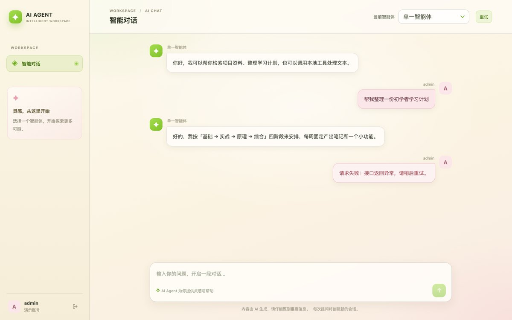
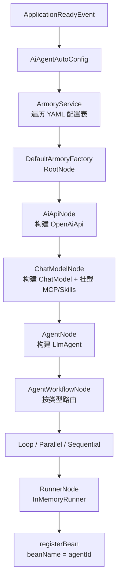
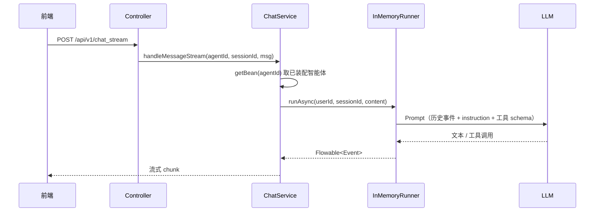
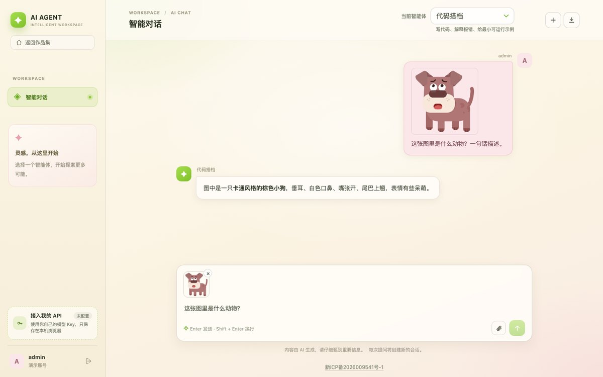
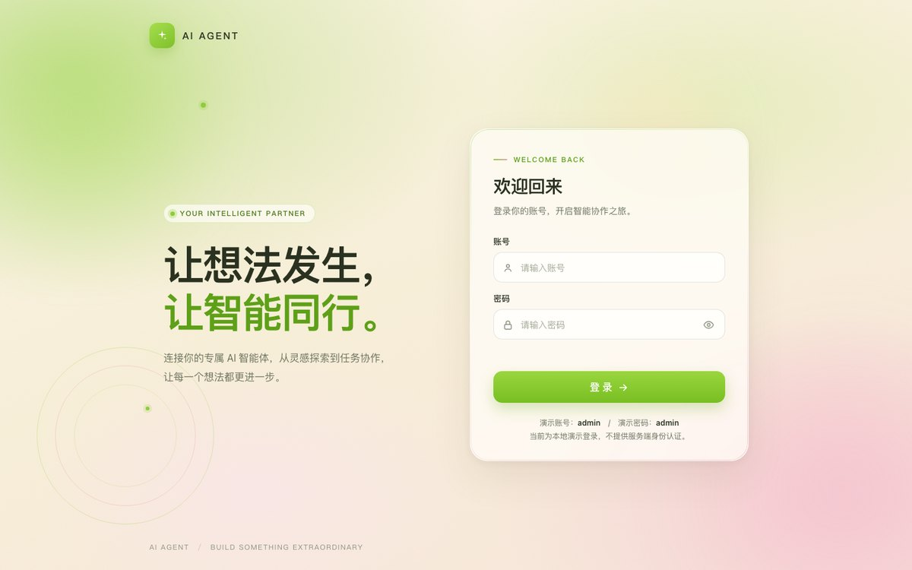
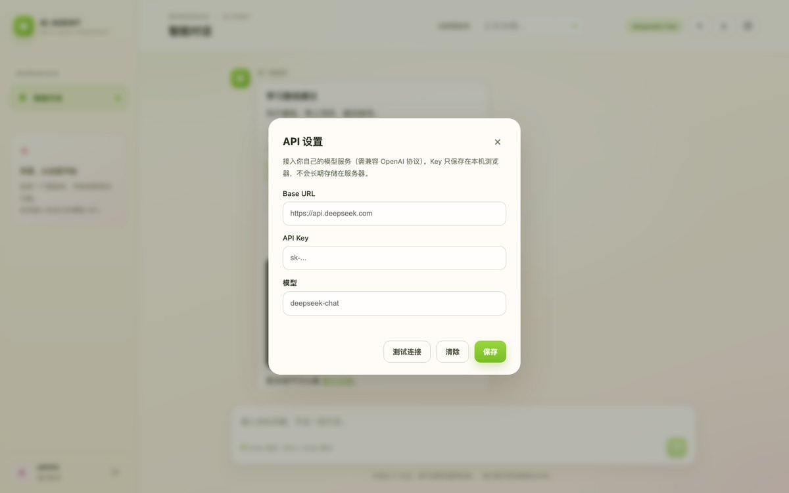

# AI Agent Scaffold

> 配置驱动的 AI Agent 脚手架：用 YAML 定义智能体，启动时自动装配成可运行的 Agent 并注册进 Spring 容器。

基于 **Spring Boot 3.4 + Google ADK + Spring AI** 构建，支持多智能体编排、MCP 工具接入、Skills 技能、流式对话、图片多模态，以及**用户自带 API Key**。



## 特性

- **配置驱动装配**：新增智能体只需在 YAML 加一段配置，不改 Java 代码
- **装配链架构**：`AiApi → ChatModel → Agent → AgentWorkflow → Runner` 责任链式装配，节点间由 `DynamicContext` 传递中间态
- **多智能体编排**：内置 Sequential / Parallel / Loop 三种工作流
- **MCP 工具**：支持本地（Spring Bean）/ SSE（远程服务）/ Stdio（子进程）三种传输
- **Skills 技能**：加载 `SKILL.md` 技能目录，让模型既有工具、也懂流程
- **流式对话**：基于 `Flowable<Event>` + `ResponseBodyEmitter` 逐字返回
- **图片多模态**：前端压缩后 base64 内联，服务端转 ADK `InlineData` 送入模型
- **自带 API Key**：用户可填写自己的模型配置，请求级装配、不落库、不覆盖默认智能体
- **工程化细节**：按用户限流、错误友好化、会话兜底、统一返回体

## 架构

### 模块划分（DDD 分层）

```
ai-agent-scaffold
├── ai-agent-scaffold-api            接口与 DTO
├── ai-agent-scaffold-app            启动模块、配置、资源（agent/ skills/）
├── ai-agent-scaffold-domain         领域层：装配链、对话服务、MCP、Skills
├── ai-agent-scaffold-trigger        HTTP 触发器
├── ai-agent-scaffold-infrastructure 基础设施（预留）
└── ai-agent-scaffold-types          通用返回码、异常
```

依赖方向：`app → trigger → domain → types`，`domain` 不感知 Web 与存储实现。

### 启动装配链路



### 一次对话



## 技术栈

| 组件 | 版本 | 说明 |
|---|---|---|
| JDK | 17 | 编译与运行 |
| Spring Boot | 3.4.3 | 容器与 Web |
| Google ADK | 0.5.0 | Agent 运行时（工作流 / Session / Plugin） |
| Spring AI | 1.1.0-M3 | ChatModel 抽象与 OpenAI 适配 |
| spring-ai-agent-utils | 0.4.2 | Skills 能力 |
| DeepSeek | OpenAI 兼容 API | 默认对话模型 |

## 快速开始

### 1. 准备配置

在 `docs/dev-ops/api/.env` 写入密钥（该文件已被 `.gitignore` 忽略）：

```bash
DEEPSEEK_API_KEY=sk-xxx          # 对话模型
BAIDU_MCP_API_KEY=bce-v3/...     # 可选：百度 AI 搜索 MCP
BAIDU_MAP_AK=xxx                 # 可选：百度地图 MCP
```

### 2. 构建并启动

```bash
export JAVA_HOME=<JDK17 路径>
mvn clean package -DskipTests

# 注意：工作目录需能命中 docs/dev-ops/api/.env
java -jar ai-agent-scaffold-app/target/ai-agent-scaffold-app.jar
```

服务默认监听 `8091`。

### 3. 启动前端

```bash
cd docs/dev-ops/nginx/html
python3 -m http.server 8080
# 或用 Nginx 托管该目录
```

先把 `config.js` 里的 `apiBaseUrl` 改成后端地址，浏览器访问 `http://localhost:8080/login.html`，演示账号 `admin / admin`。

## 配置示例

```yaml
ai:
  agent:
    config:
      tables:
        learningAgent:
          app-name: learningAgent
          agent:
            agent-id: 100002          # 最终注册的 Bean 名
            agent-name: 学习规划师
            agent-desc: 联网检索项目资料，按阶段给出学习计划
          module:
            ai-api:
              base-url: https://api.deepseek.com
              api-key: ${DEEPSEEK_API_KEY:}
              completions-path: v1/chat/completions
            chat-model:
              model: deepseek-chat
              tool-mcp-list:
                - sse:
                    name: baidu-search
                    base-uri: http://appbuilder.baidu.com/v2/ai_search/mcp/
                    sse-endpoint: sse?api_key=${BAIDU_MCP_API_KEY:}
                    request-timeout: 5000
              tool-skills-list:
                - type: resource
                  path: agent/skills
            agents:
              - name: learningAgent
                instruction: |
                  先检索核实，再给可执行的学习计划。
          runner:
            agent-name: learningAgent
            plugin-name-list: [myTestPlugin, myLogPlugin]
```

当前共配置 5 个智能体：学习规划师（带 MCP + Skills）、通用助手、代码搭档、写作润色、翻译官。

## 接口

| 方法 | 路径 | 说明 |
|---|---|---|
| GET | `/api/v1/query_ai_agent_config_list` | 智能体列表 |
| POST | `/api/v1/create_session` | 创建会话 |
| POST | `/api/v1/chat` | 对话（支持图片，返回完整内容 + sessionId） |
| POST | `/api/v1/chat_stream` | 流式对话 |
| POST | `/api/v1/test_api` | 模型连通性测试 |

统一返回体：`{ "code": "0000", "info": "成功", "data": {...} }`

## 界面

| 对话（Markdown 渲染） | 图片识别 |
| --- | --- |
|  |  |

| 登录页 | 自带 API Key 设置 |
| --- | --- |
|  |  |

## 目录结构

```
ai-agent-scaffold-app/src/main/resources/
├── agent/
│   ├── only-one-agent.yml     # 智能体配置（5 个）
│   └── skills/                # 技能目录（battle-plan / pdf）
├── application-dev.yml        # 配置导入与数据源
└── logback-spring.xml

ai-agent-scaffold-domain/src/main/java/.../service/
├── armory/
│   ├── node/                  # 装配节点
│   ├── matter/mcp/            # MCP 客户端工厂与实现
│   ├── matter/skills/         # Skills 构建
│   ├── matter/plugin/         # ADK 插件
│   └── matter/springai/       # 多模态适配层
└── chat/ChatService.java      # 会话与对话
```

## 设计要点

**为什么用装配链而不是一个大方法？**
每个节点单一职责（建 API / 建模型 / 建 Agent / 建 Runner），靠 `DynamicContext` 传状态；扩展只需插入节点，不动其它环节。

**为什么 Bean 名用 agentId？**
运行期唯一的索引就是 agentId，`getBean(agentId)` 直接拿到带 Runner 的智能体，省掉一层映射。

**多轮上下文怎么实现？**
不自己拼 message 数组，交给 ADK 的 Session 保存历史事件；同一 sessionId 再次执行时 Runner 会把历史一并构造进 Prompt。

**用户自带 Key 如何不污染全局？**
在装配上下文里覆盖 `openAiApi` / `model` 并设置 `skipRegisterBean=true`，按配置指纹做 LRU 缓存；Key 只存浏览器 localStorage，请求级使用。

## 已知限制

- 会话存储在内存（`InMemoryRunner`），重启丢失、多实例不共享
- 登录为前端 Cookie 演示，无服务端鉴权，仅适合内网/演示环境
- 配置变更需重启生效
- 尚无调用量/延迟等可观测性埋点

## 说明

本项目在学习用 DDD 脚手架的工程结构上实现，装配链、MCP、Skills 等设计思路参考相关开源实践，模型接入、图片多模态、自带 API Key、多智能体与前端部分为个人改造实现。仅用于学习与技术交流。

## License

[MIT](LICENSE)
